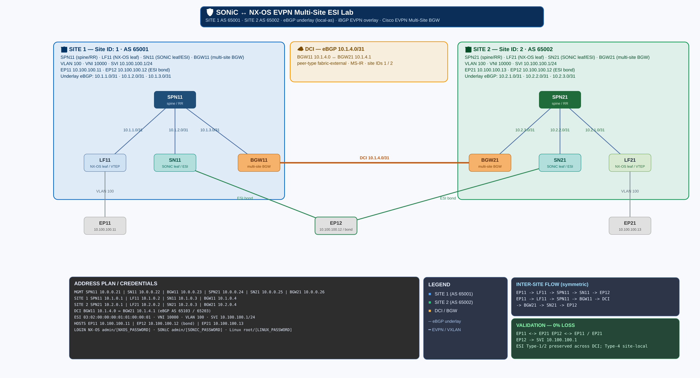

# SONiC ↔ NX-OS EVPN Multi-Site ESI Lab

Two-site EVPN multi-site lab built in EVE-NG. Each site has a Cisco N9Kv
spine (BGP route reflector), an N9Kv leaf, an N9Kv EVPN Multi-Site border
gateway, and a SONiC leaf providing RFC 7432 ESI. The underlay is eBGP; the
overlay is iBGP EVPN; the DCI is a Cisco EVPN Multi-Site border-gateway pair.

EP12 is dual-homed to the two SONiC leaves with an ESI LAG and an anycast
gateway, so it stays reachable across the DCI and during leaf failover.



Animated SVG: [`docs/SONIC_ESI_MULTISITE_ANIMATED.svg`](docs/SONIC_ESI_MULTISITE_ANIMATED.svg)
— open the raw SVG in a browser to see the moving dashes and packet dots.

The diagram uses a high-contrast NOC theme: glass site cards with `01`/`02`
badges, glowing Cisco 19 stencils, a central DCI core, animated packet dots,
and compact flow/address panels.

The SVG is self-contained and uses actual Cisco 19 stencil paths:
`mxgraph.cisco19.nexus_9300` for all switches (N9Kv and SONiC) and
`mxgraph.cisco19.server` for hosts. The Cisco 19 library has no literal
`nexus_9000v` shape; `nexus_9300` is the closest 9000-series switch icon and
is labeled accordingly. In DC2 the row is **BGW21 — SN21 — LF21**, with the
SONiC leaf centered. Node geometry is icon-sized so the links meet the Cisco
icon borders; site-box margins are balanced.

## What is in the lab

| Site | Spine | NX-OS leaf | Border GW | SONiC leaf | Hosts |
|---|---|---|---|---|---|
| 1 (Site ID 1) | SPN11 | LF11 | BGW11 | SN11 | EP11 (LF11), EP12 (ESI bond) |
| 2 (Site ID 2) | SPN21 | LF21 | BGW21 | SN21 | EP21 (LF21), EP12 (ESI bond) |

- **Site 1**: AS 65001, underlay local-as 65100–65103.
- **Site 2**: AS 65002, underlay local-as 65200–65203.
- **DCI underlay**: BGW11 E1/1 ↔ BGW21 E1/1, `10.1.4.0/31`.
- **DCI EVPN**: eBGP over loopbacks `1.1.1.10` ↔ `2.2.2.10`,
  `ebgp-multihop 2`, `peer-type fabric-external`.
- **ESI**: `03:02:00:00:00:01:01:00:00:01` on `PortChannel100` on SN11/SN21;
  EP12 `bond0` 802.3ad (LACP) at `10.100.100.12/24`.
- **VXLAN**: VLAN 100, VNI 10000, anycast SVI `10.100.100.1/24`.

## Design highlights

- **eBGP underlay with per-device `local-as`**: every fabric link is eBGP, and
  each device uses a unique local-as (`no-prepend replace-as`) while keeping
  its global AS for the EVPN overlay.
- **iBGP EVPN overlay**: SPN11/SPN21 are route reflectors; LF11/SN11/BGW11 and
  LF21/SN21/BGW21 are clients.
- **Cisco EVPN Multi-Site BGW**: site IDs 1/2, `rd dual id 1/2`, MS-IR,
  `PRESERVE_ESI_FABRIC` / `PRESERVE_ESI_DCI` route-maps with `set esi unchanged`.
- **SONiC ESI**: FRR `evpn mh es-id` / `es-sys-mac` on `PortChannel100`; Type-4
  DF election is site-local.
- **Type-1/2 across the DCI**: the BGWs preserve the ESI on Type-1/2, so the
  remote site sees the ESI for the dual-homed host. Type-4 is not re-originated.
- **Native EVE-NG Pro traffic filters**: live BPF-based link highlighting for
  the ICMP host flow and the VXLAN underlay (optional; see
  [`docs/traffic-filters.md`](docs/traffic-filters.md)).

## Address / ASN quick reference

| Item | Value |
|---|---|
| Site 1 global AS | 65001 |
| Site 2 global AS | 65002 |
| Underlay local-as | SPN11 65100, LF11 65101, SN11 65102, BGW11 65103 |
|  | SPN21 65200, LF21 65201, SN21 65202, BGW21 65203 |
| DCI underlay | `10.1.4.0/31` |
| DCI EVPN loopbacks | `1.1.1.10` ↔ `2.2.2.10` |
| VLAN / VNI | 100 / 10000 |
| Anycast SVI | `10.100.100.1/24` |
| ESI | `03:02:00:00:00:01:01:00:00:01` |
| Hosts | EP11 `.11`, EP12 `.12`, EP21 `.13` in `10.100.100.0/24` |

Full tables: [`docs/ip-plan.md`](docs/ip-plan.md).

## Validation (live, 0% loss)

| Flow / check | Result |
|---|---|
| EP11 `10.100.100.11` ↔ EP21 `10.100.100.13` | 0% loss |
| EP12 `10.100.100.12` ↔ EP11 / EP21 | 0% loss |
| EP12 → anycast SVI `10.100.100.1` | 0% loss |
| BGW VNI 10000 | Up (`UnicastBGP`, MS-IR) |
| Type-1/2 ESI across DCI | preserved |
| Type-4 | site-local (expected Cisco multi-site behavior) |

EP12 failover: disabling `PortChannel100` on SN11 leaves EP12 reachable
through SN21 (1 port, 0% loss); restoring returns 2 ports and 0% loss.

## Repository layout

```
.
├── README.md
├── topology/
│   ├── topology.png                         # static frame of the animated SVG
│   └── SONIC_ESI_MULTISITE.unl              # EVE-NG lab file (sanitized)
├── configs/
│   ├── nxos/                                # SPN11/21, LF11/21, BGW11/21
│   ├── sonic/SN11, SN21/                    # FRR + lab CONFIG_DB subset
│   └── hosts/                               # EP11/EP12/EP21 host state
├── docs/
│   ├── architecture.md
│   ├── ip-plan.md
│   ├── build-guide.md
│   ├── validation.md
│   ├── troubleshooting.md
│   ├── traffic-filters.md
│   ├── SONIC_ESI_MULTISITE_ANIMATED.svg
│   └── canvas.md
└── validation/
    └── traffic_filters.json
```

## Prerequisites

- EVE-NG 6.x (Pro for the native traffic-filter feature).
- N9Kv image `nxosv9k-10.6.3.F`.
- SONiC VS image (202511 branch): [sonic-vs.img.gz](https://sonic-build.azurewebsites.net/api/sonic/artifacts?branchName=202511&platform=vs&target=target%2Fsonic-vs.img.gz).
  The lab runs `SONiC.202511.1275431-72b5bece8`; the link downloads the latest 202511 VS build.
  Installation images: <https://sonic.software>.
  EVE-NG image name: `sonicsw-202511`.
- A Linux host image for EP11/EP12/EP21.
- Management network `10.0.0.0/24` (gateway `10.0.0.254`).

## Quick start

1. Import `topology/SONIC_ESI_MULTISITE.unl` into EVE-NG under
   `/Users/<user>/SONIC_ESI_MULTISITE.unl`.
2. Apply the NX-OS and SONiC configs from `configs/` (replace management IPs,
   image paths, and credentials).
3. Configure EP11/EP12/EP21 from `configs/hosts/` and `docs/ip-plan.md`.
4. Verify with `docs/validation.md`; optionally add the Pro traffic filters
   from `validation/traffic_filters.json`.

## Native EVE-NG traffic filters (Pro)

The lab includes two live filters:

- `EP11 <-> EP21 ICMP` — `icmp and host 10.100.100.11 and host 10.100.100.13`
- `VXLAN underlay` — `udp port 4789`

Open the lab, click the filter icon → **Traffic Filters**, and run traffic
(e.g. `ping -i 1 10.100.100.13` from EP11). Matching links highlight in the
filter color. See [`docs/traffic-filters.md`](docs/traffic-filters.md).

## Credentials

The published configs are sanitized. Use your own lab credentials:

- NX-OS: `admin` / `<lab password>`
- SONiC: `admin` / `<lab password>`
- Linux hosts: `root` / `<lab password>`

Management IPs: SPN11 `10.0.0.21`, SN11 `10.0.0.22`, BGW11 `10.0.0.33`,
SPN21 `10.0.0.24`, BGW21 `10.0.0.34`. LF11, LF21, and SN21 are console-only
(no management IPv4).

## Caveats

- `dci-advertise-pip` must remain disabled; enabling it removed the remote VIP
  NVE peer and broke cross-site BUM/ARP.
- The BGW VNI needs both `multisite ingress-replication` and
  `ingress-replication protocol bgp` or it stays Down.
- SONiC ESI/FRR is applied via `vtysh`, not CONFIG_DB; it does not survive a
  `bgp` restart. Add a systemd hook for persistence.
- N9Kv 10.6.3.F has no ESI/EVPN-MH; ESI is SONiC↔SONiC. LF11/LF21 are
  underlay/VTEP devices.
- SN21 SSH is unavailable in this lab; use the EVE console. SN11 SSH works
  after `iptables -F INPUT`.
- EP12's captured host state includes stale `10.99.99.10` addresses on eth0/eth1
  from an earlier lab; the active lab address is on `bond0` (`10.100.100.12`).
